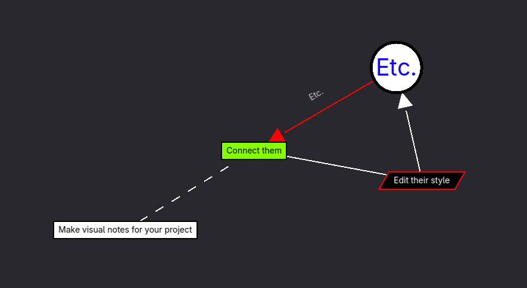

#  Godot Mind Map Planner
This plugin allows you to create mind map graphs inside Godot. Its main use is for planning and mapping out ideas inside your project.

This description is work in progress.

___
You can find all my addons on my [profile page](https://github.com/KoBeWi).

